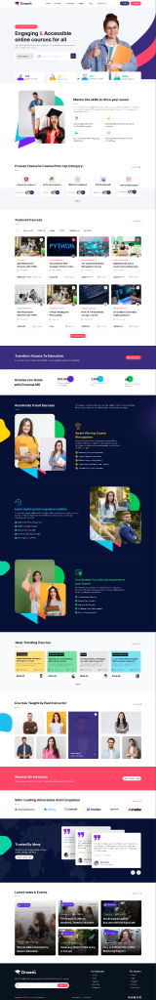
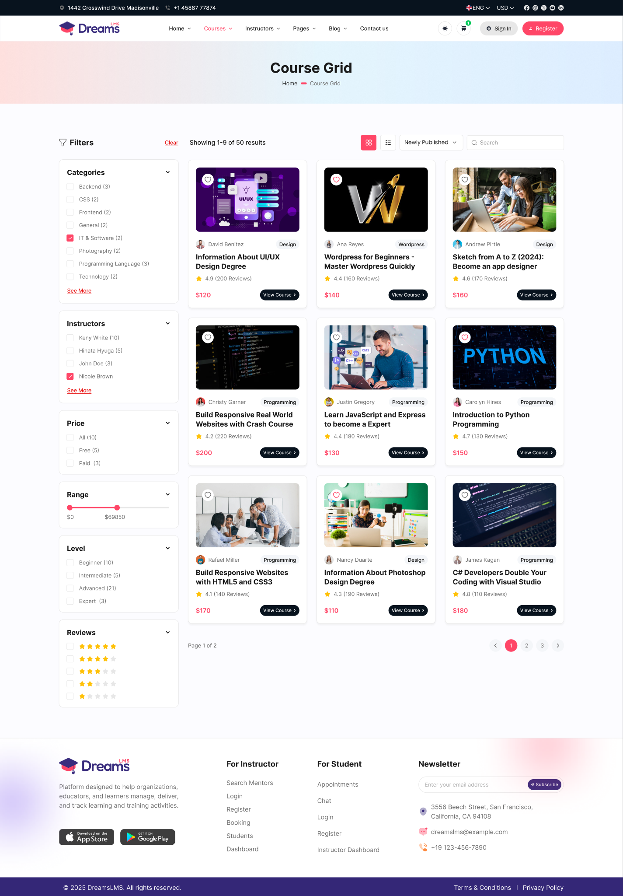
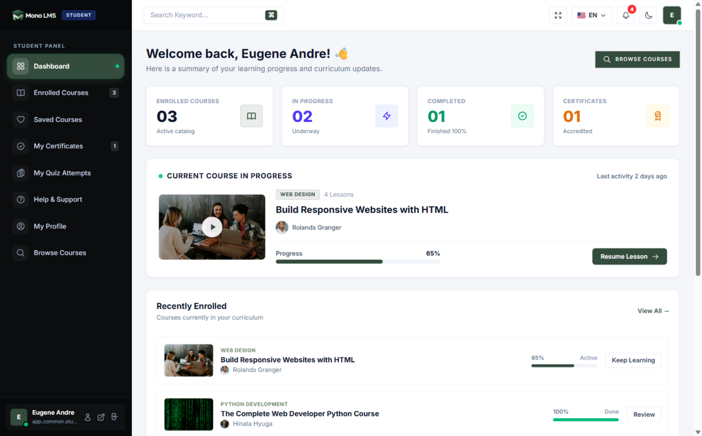
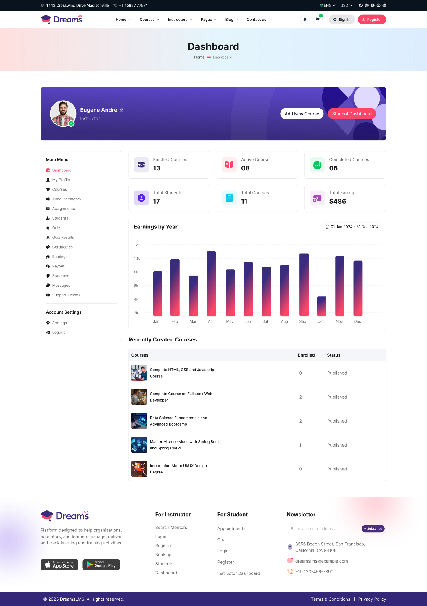
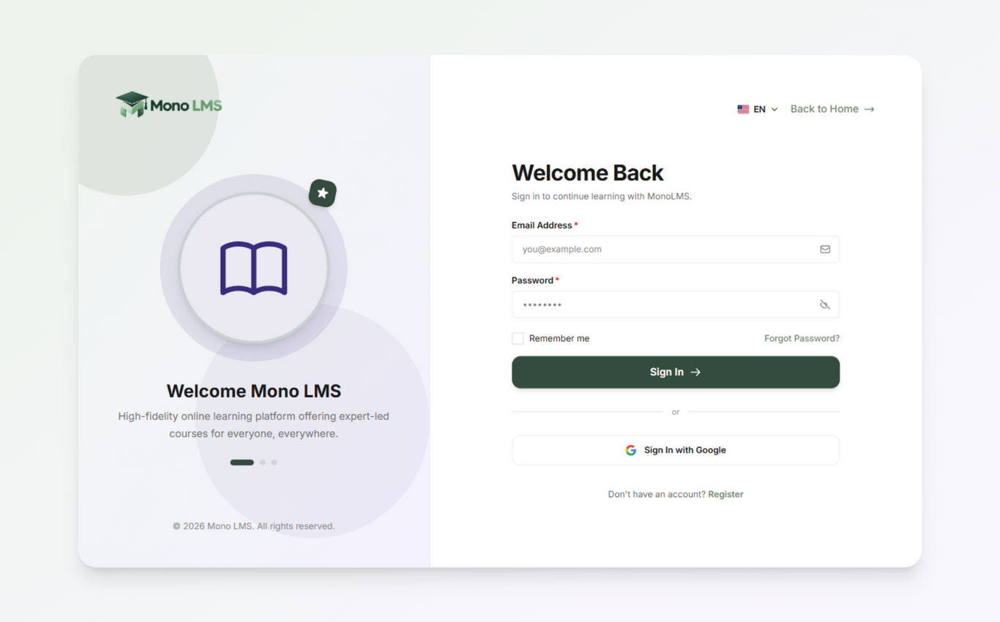

# Dreams LMS – Learning Management System

> High-fidelity, pixel-perfect Laravel 13 & Tailwind CSS v4 implementation of the **Dreams LMS Figma UI Kit**.

[](https://laravel.com)
[](https://tailwindcss.com)
[](https://php.net)
[](https://sqlite.org)
[](#tests)

---

## 📸 Visual Demos & Screenshots

All screens are designed in Figma Dev Mode and mapped to structured Blade components.

### 1. Home (`/`)


### 2. Course Grid (`/courses/grid`)


### 3. Student Dashboard (`/student/dashboard`)


### 4. Instructor Dashboard (`/instructor/dashboard`)


### 5. Authentication Screen (`/login`)


---

## 🧭 Complete Screens & Route Directory

All 22 screens can be browsed and accessed from the interactive **Screens Showcase Hub** at [`/screens`](http://localhost/lms/public/screens):

| Category | Screen Name | Route | Figma Node ID |
| :--- | :--- | :--- | :--- |
| **Home** | Home *(Main and Only Home)* | `/` | `2355:29907` |
| **Hub** | Screens Showcase Hub | `/screens` | `1:4659` |
| **Courses** | Course Grid | `/courses/grid` | `200:18274` |
| | Course List | `/courses/list` | `200:19012` |
| | Course Details | `/courses/detail` | `200:19760` |
| **Instructors** | Instructor Grid | `/instructors/grid` | `235:21516` |
| | Instructor List | `/instructors/list` | `235:21980` |
| | Instructor Profile | `/instructors/detail` | `235:22430` |
| **Student Portal** | Student Dashboard | `/student/dashboard` | `235:23080` |
| | Student Profile | `/student/profile` | `235:23450` |
| | Enrolled Courses | `/student/enrolled-courses`| `235:23890` |
| | Certificates | `/student/certificates` | `235:24210` |
| | Quiz Attempts | `/student/quiz-attempts` | `235:24550` |
| **Instructor Portal**| Instructor Dashboard | `/instructor/dashboard` | `375:48500` |
| | Manage Courses | `/instructor/courses` | `375:48920` |
| | Student Reviews | `/instructor/reviews` | `375:49310` |
| **Authentication** | Sign In | `/login` | `375:49416` |
| | Register | `/register` | `375:49512` |
| | Forgot Password | `/forgot-password` | `375:49601` |
| | Enter OTP | `/otp` | `375:49627` |
| | Set New Password | `/set-password` | `375:50135` |
| | Lock Screen | `/lock-screen` | `375:50392` |

---

## 🛠️ Tech Stack & Architecture

- **Backend Framework**: [Laravel 13](https://laravel.com) on **PHP 8.4 / 8.5**
- **Styling**: [Tailwind CSS v4](https://tailwindcss.com) with `@theme` design tokens
- **Font Foundations**: Inter & Montserrat typography
- **Frontend Build**: [Vite](https://vitejs.dev) with production pre-compiled assets in `public/build/`
- **Database**: SQLite pre-migrated database (`database/database.sqlite`)
- **Blade Architecture**:
  - `<x-layouts.app>`: Standard customer-facing header, main content, and footer
  - `<x-layouts.dashboard>`: Shared portal layout for Students and Instructors with active sidebar navigation
  - `<x-layouts.auth>`: Split-screen branding layout for authentication flows
  - Reusable components: `<x-header>`, `<x-footer>`, `<x-dashboard.sidebar>`

---

## 🚀 Quick Start Guide

### Prerequisites
- PHP 8.4 or higher with `pdo_sqlite` and `sqlite3` extensions enabled
- Composer
- Node.js & npm (optional, as pre-compiled build assets are included)

### 1. Clone the Repository
```bash
git clone https://github.com/goutam2597/mono-lms.git
cd mono-lms
```

### 2. Install PHP Dependencies
```bash
composer install
```

### 3. Environment Setup
```bash
cp .env.example .env
php artisan key:generate
```

### 4. Database Setup
The SQLite database `database/database.sqlite` is already tracked and migrated with required session and cache tables.
If needed, you can run:
```bash
php artisan migrate
```

### 5. Build Assets (Optional)
Production assets are already included in `public/build/`. To start Vite in dev mode:
```bash
npm install
npm run dev
# or for production build:
npm run build
```

### 6. Start the Application
Run via Laravel Artisan:
```bash
php artisan serve
```
Visit: [http://127.0.0.1:8000](http://127.0.0.1:8000) or browse all screens at [http://127.0.0.1:8000/screens](http://127.0.0.1:8000/screens).

Or if using **Laragon / Apache**:
Visit: `http://localhost/lms/public` or `http://localhost/lms/public/screens`.

---

## 🧪 Testing

Run the feature test suite covering all 22 screens:
```bash
php artisan test --compact
```

---

## 📄 License
The MIT License (MIT).
